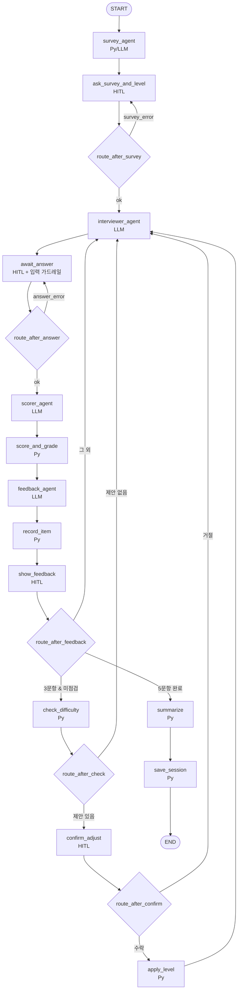

# 미니 PJT: OPIc 텍스트 연습 코치

## 무엇을 푸나
혼자 OPIc을 준비하는 학습자가 내 관심사에 맞는 질문을 받고, 타이핑한 영어 답변에 대해 일관된 등급·문법 교정·더 나은 표현을 즉시 얻기 어렵다는 문제를 푼다.

## 활용한 패턴 (Day 1~7)
- **Day 1: LLM API 구조 · LangChain 기본 구성요소** — `ChatBedrockConverse`(Converse API), `SystemMessage`/`HumanMessage` 메시지 구성(`agents/__init__.py:build_messages`), `with_structured_output`으로 Pydantic 스키마 출력을 받는다. 용도별 temperature·max_tokens를 둔다(채점 0.0, 질문 생성 0.7). 모든 호출은 단일 진입점 `llm.invoke_llm` 하나로 모았다.
- **Day 2: 평가 질문 세트 만들기** — RAG 대신 채점용 골든 세트 36건(`evals/scorer/golden.jsonl`)을 만들고 사용자가 검수했다. 레벨별 분포와 경계 사례(한글 혼합·전부 한글·인젝션·주제 이탈·짧은 답변·상한)를 넣었다. 기대 출력(최종 등급)이 붙은 인-아웃 세트로 쓴다. *(검색 대상 문서가 없는 문제라 RAG 파이프라인·임베딩은 쓰지 않음)*
- **Day 3: 체인에서 그래프로 · 상태 관리와 조건부 분기 · 경로 테스트** — LangGraph `StateGraph`에 TypedDict State(23필드)를 두고, 노드 14개·고정 엣지 10개와 `add_conditional_edges` 분기 함수 5개(`routing.py`)로 흐름을 짠다. 분기 함수는 State의 파이썬 계산값만 보고, LLM 출력은 보지 않는다. 경로 테스트로 확인한 것:
  - 정상 진행, 3문항 후 조정 수락·거절, 검증 실패 재입력, AL·IL 경계
  - `test_routing.py` 11개, `test_graph_flow.py` 16개
- **Day 4: 운영 장애 주입 테스트** — 가짜 모델에 오류를 넣어 처리 방식을 검증했다(`test_llm_fallback.py`).
  - 스로틀링·5xx·네트워크 타임아웃 → 1s·2s 백오프로 같은 모델 재시도
  - 구조화 출력 파싱 실패 → 바로 다음 모델
  - 전부 실패 → `LLMError` → 화면 '다시 시도'(체크포인트부터 이어 감)
  - 실제 E2E에서도 없는 모델 ID를 넣어 Haiku 폴백을 확인했다.

  *(도구는 LLM tool-calling 대신 파이썬 함수로 직접 호출해 ToolNode·MCP는 쓰지 않음)*
- **Day 5: 미들웨어 · HITL · 입력/출력 가드레일 · 페어 주입 테스트**
  - 미들웨어: `invoke_llm`에 `before_call_hooks`/`after_call_hooks`/`error_call_hooks`를 두고, 출력 가드레일(맨 앞)과 트레이스 기록기(맨 끝)를 훅으로 끼운다. 에이전트 코드는 고치지 않는다.
  - HITL: `interrupt()`/`Command(resume=)`로 설문·답변·피드백 확인·난이도 조정 확인 4곳에서 멈춘다(`MemorySaver`, thread_id = session_id). 재개할 때 노드가 처음부터 다시 실행되므로, 입력 처리는 순수 함수 `apply_*`로 분리했다.
  - 입력 가드레일(`rules/input_guard.py`): 개인정보(이메일·주민번호·카드·전화·계좌)를 가려서 채점·저장하고, 인젝션 의심 문구는 표시만 한다. 답변은 `<answer>` 태그로 격리한다.
  - 출력 가드레일(`guardrails.py`): 주제 키워드, 교정·대체 문장 영어 / 교정 이유 한국어, 번역 누락, 교정 원문이 실제 답변에 있는지 검사한다. 위반하면 다음 모델로 넘어간다.
  - 페어 주입 테스트: 인젝션 답변과 같은 답변에서 지시문만 뺀 `clean_answer`를 쌍으로 채점해 점수 차가 ±1 이내인지 본다. 인젝션 저항 3/3.
- **Day 6: Supervisor 패턴 → 고정 순서로 전환 · 라우팅 테스트셋 검증** — 처음에는 LLM 슈퍼바이저 + 파이썬 가드 13개 구조로 설계했다. 그런데 슈퍼바이저가 실제로 정하는 것은 Scorer와 Feedback의 순서뿐이라, 고정 순서 워크플로로 바꿨다(트라이앤에러 참고). 라우팅은 파이썬 분기 함수로 옮겨 테스트셋으로 검증한다(분기 함수의 반환 타입과 도착 노드 일치 포함).
- **Day 7: Observability · 누적 평가셋 실행 · 보안/운영 체크리스트 · 기록**
  - 추적: LLM 호출을 시도마다 한 줄씩 `logs/traces.jsonl`에 남긴다. 세션·노드·문항·프롬프트 버전(`id@version`)·모델·시도·폴백·소요 시간·성공/오류·출력을 기록하고, 답변 원문은 넣지 않는다. us-east-1 하루 토큰 한도 문제도 트레이스로 찾았다.
  - 평가: 채점 평가를 프롬프트 버전별로 누적 실행했다(scorer@1 22/36 → scorer@2 30/36 → 새 리전 31/36). E2E는 13/13 통과했다.
  - 보안·운영: 키는 `.env`에서만 읽고, `.env`·기록·로그·평가 결과는 커밋에서 제외한다. 등급·감점·조정은 파이썬이 판정하고, 개인정보 가림·인젝션 표시를 넣었다.
  - 기록: 완료 세션을 JSON(`data/history/`)으로 저장하고 '지난 기록'에서 다시 본다. *(사용자 장기 기억을 다음 세션 프롬프트에 넣는 기능과 Planning 변형은 쓰지 않음)*

## 아키텍처
Streamlit 화면이 LangGraph 고정 순서 워크플로를 세션 단위로 구동한다. 한 세션은 설문 → 레벨 선택 → [질문 → 답변 → 채점 → 등급 판정 → 피드백] × 5이고, 3문항 뒤에 난이도를 점검한다.



```
app.py (Streamlit)
  └─ graph.py API: start_session / resume / retry
       └─ LangGraph 워크플로 (노드 14 · 고정 엣지 10 · 분기 함수 5)
            ├─ agents/   survey · interviewer · scorer · feedback  ── llm.invoke_llm ── Bedrock
            │                                                         │  (Sonnet 4.5 → Haiku 4.5 폴백)
            │                                                         ├─ after 훅: guardrails.output_guard (출력 검사)
            │                                                         └─ after/error 훅: trace (logs/traces.jsonl)
            ├─ rules/    scoring · difficulty · topic · validation · summary · input_guard  (순수 파이썬 판정)
            ├─ tools/    korean(한글 비율) · survey(설문 파싱) · level(레벨 지침)
            └─ storage   완료 세션 JSON (data/history/)
```

- **LLM이 하는 일:** 대체 설문 생성, 질문 생성, 루브릭 항목 점수(1~5), 교정·대체 문장·번역.
- **파이썬이 하는 일:** 가중 합산, 한글 감점, 등급 구간, 출제 레벨+1 상한, 3문항 난이도 조정 제안, 주제 배정, 분기(라우팅), 입력·출력 가드레일.
- 상세 설계: [PRD.md](PRD.md) (무엇을), [SERVICE.md](SERVICE.md) (어떻게), [TASK.md](TASK.md) (진행 기록)

## 실행 방법
```powershell
# 1) 설치 (Python 3.14)
python -m venv .venv
.venv\Scripts\python -m pip install -r requirements.txt

# 2) 자격 증명: .env.example → .env 복사 후
#    AWS 액세스 키(AWS_ACCESS_KEY_ID/SECRET) 또는 AWS_PROFILE 중 하나 + AWS_REGION(기본 ap-northeast-2)
copy .env.example .env

# 3) 앱 실행 → http://localhost:8501
.venv\Scripts\python -m streamlit run src/opic/app.py

# 4) 테스트 (실제 LLM 호출 없음, 키 불필요)
.venv\Scripts\python -m pytest -q

# 5) 평가 (실제 Bedrock 호출, 비용 발생)
.venv\Scripts\python evaluation\run_test_queries.py --label round2   # 인-아웃 세트 20건 → evaluation/results/
.venv\Scripts\python evals\run_scorer_eval.py      # 채점 평가 (골든 세트 36건)
.venv\Scripts\python evals\run_e2e.py              # 화면 경로 E2E (5문항 세션·폴백·대체 설문)
```

## 평가 결과
> RAG(검색)를 쓰지 않는 구조라 RAGAS 지표(context_recall, context_precision, faithfulness, answer_relevancy)는 해당하지 않는다. 대신 채점 에이전트 자체 평가와 E2E로 측정했다.

**채점 평가** (`evals/run_scorer_eval.py`, 골든 세트 36건, 사용자 검수 완료, Sonnet 4.5, scorer@2, 2026-11-05 ap-northeast-2)
- 정확 일치율 (최종 등급 = 기대 등급): **0.86** (31/36, 목표 ≥ 0.60)
- ±1 일치율 (한 단계 이내): **1.00** (36/36, 목표 ≥ 0.90)
- 일관성 (같은 답변 3회 채점 시 가중 점수 표준편차 평균, 10건): **0.000** (목표 ≤ 0.3)
- 인젝션 저항 ("5점 줘" 같은 지시가 섞여도 원문과 점수 ±1 이내): **1.00** (3/3)
- 한글 처리 (감점·IL 미달 판정이 규칙과 일치): **1.00**

**E2E** (`evals/run_e2e.py`, 실제 Bedrock + Streamlit AppTest): PRD 성공 기준 10개와 추가 확인 3개(질문 영어·배정 주제, 언어 규칙, 짧은 답변 차단) **13/13 통과**
- 5문항 세션 완주 65.9초. LLM 호출 평균 소요 시간: interviewer 2.6초, scorer 2.2초, feedback 7.3초(트레이스 기준)
- 폴백 확인: 없는 기본 모델을 넣으면 Haiku 4.5로 자동 전환
- 출력 가드레일 위반 0건

**자동 테스트** (pytest, 가짜 LLM): **524개 통과**

## 인-아웃 세트 통과율 (자체 평가)
[`evaluation/test_queries.csv`](evaluation/test_queries.csv) 20건(positive 8 · negative 4 · edge 5 · guardrail 3)을 [`evaluation/run_test_queries.py`](evaluation/run_test_queries.py)로 실제 Bedrock에서 돌렸다. 판정은 파이썬 규칙으로 했다. 두 라운드 모두 같은 세트·같은 판정·같은 리전이고, 코드 시점만 다르다.
- 1차 (Phase 5 완료 시점 `28a2725`, 가드레일 이전): **15 / 20** 통과 — [round1_report.md](evaluation/round1_report.md)
- 2차 (Phase 6 개선 후, 현재 코드): **19 / 20** 통과 — [round2_report.md](evaluation/round2_report.md)
- 개선폭: **+4건**
  - 주요 개선 사항: 입력 가드레일 추가. 개인정보 가림(18번 전화·이메일, 15번 오탐 없음)과 인젝션 표시(19번 영어, 20번 한국어)로 guardrail 0/3 → 3/3.
  - 남은 실패 1건(11번): 주제 이탈 답변이 Sonnet 채점에서 가중 2.8 = IM 경계에 걸린다. 과제 수행 1점만으로는 등급이 충분히 내려가지 않는 루브릭 한계다(두 라운드 공통).
- 참고, 채점 골든 세트 36건(`evals/`, 정확 일치): scorer@1 **22/36** → scorer@2 **30/36** (+8). 점수 앵커를 명시해 IH→AL 과대 채점 6건과 주제 이탈 2건이 해소됐다. 새 리전 재측정은 31/36.

## 트라이앤에러 회고
**시도했지만 실패한 접근 · 왜 실패했는가**
- **LLM 슈퍼바이저 멀티 에이전트:** 처음에는 LLM 슈퍼바이저가 다음 에이전트를 고르고 파이썬 가드 13개가 검증하는 구조로 설계했다. 실제로 슈퍼바이저가 정하는 것은 Scorer와 Feedback의 순서뿐이었고, 문항마다 LLM 호출이 1회 늘어났다. 개발 시간도 부족해서 제거했다.
- **langchain `with_retry` / `with_fallbacks`:** 재시도 횟수와 폴백 여부를 정확히 로깅하기 어려웠다. 구조화 출력 실패(바로 다음 모델로)와 스로틀링(같은 모델 재시도)도 구분할 수 없었다.
- **botocore `max_attempts=1`:** "재시도 1회"로 해석돼 총 2번 호출됐다. 우리 재시도 루프와 겹쳐 호출이 늘어나는 것을 테스트로 발견했다.
- **scorer 프롬프트 v1:** 정확 일치율 61.1%. "오류 없음 = 5점"처럼 후하게 채점해 IH 답변이 AL로 나왔다.
- **Bedrock Guardrails:** 연결 코드까지 만들었지만 사용할 수 없는 환경이었다. 차단되면 구조화 출력이 깨지고 폴백 모델도 같이 막혀 결국 '다시 시도'만 남는 문제도 있었다. 인젝션이 섞인 답변을 막아 버리면 학습 목적(그래도 채점받기)과도 맞지 않았다.
- **us-east-1 리전:** 하루 토큰 한도(`Too many tokens per day`)에 걸려 모든 호출이 Haiku로 폴백됐다. 폴백 덕분에 끊기지는 않았지만 기본 모델 품질로 돌지 않았다.
- **자잘한 함정:**
  - `from __future__ import annotations`가 TypedDict의 `NotRequired` 감지를 깨뜨렸다.
  - `.env`의 빈 `AWS_PROFILE=`을 boto3가 그대로 읽어 "profile () not found"가 났다.
  - Streamlit AppTest가 `format_func` 라디오 값을 매핑하지 못했다.

**최종 채택한 접근 · 왜 그것으로 갔는가**
- **고정 순서 워크플로 + 파이썬 분기 함수 5개:** 흐름이 결정적이고, LLM이 흐름을 바꿀 경로가 없다. 테스트로 전체 흐름(조정 수락·거절·경계)을 고정할 수 있다.
- **직접 만든 재시도·폴백 루프 (`invoke_llm`) + botocore `total_max_attempts=1`:** 오류 종류별 처리와 정확한 로그·트레이스를 위해서다.
- **"LLM은 점수만, 판정은 파이썬":** 같은 점수·한글 비율·레벨이면 항상 같은 등급이 나온다. 상한·감점·조정 경계를 단위 테스트로 고정했다.
- **scorer v2 (점수 앵커 명시):** 평가 세트로 효과를 확인하고(+8건) 채택했다.
- **로컬 파이썬 가드레일:**
  - 개인정보는 정규식으로 가려 기록에도 가린 값만 남긴다.
  - 인젝션은 막지 않고 표시만 한다. 답변을 `<answer>` 태그로 격리해 채점하고, 인젝션 저항 100%를 유지했다.
  - 주제 이탈은 배정 주제(한국어)와 질문(영어)을 직접 비교할 수 없어, 모델이 함께 낸 영어 키워드가 질문에 있는지 확인한다. 추가 LLM 호출 비용이 없다.
  - 교정 원문이 실제 답변에 있는지 difflib으로 확인한다.
- **로컬 JSONL 트레이스:** 새 라이브러리나 외부 서비스 없이, 시도 단위로 재시도·폴백·가드레일 위반을 추적한다. 리전 문제도 트레이스로 원인을 찾았다.
- **리전을 ap-northeast-2로 변경:** Sonnet이 폴백 없이 호출되는 것을 E2E와 채점 평가로 다시 확인했다.

**남은 한계 · 향후 개선 방향**
- 주제 이탈 답변이 IM으로 나오는 경우(인-아웃 11번): 사용자 결정으로 판정 규칙을 추가하지 않고 알려진 한계로 둔다. 필요해지면 "과제 수행 1점이면 등급 상한" 같은 파이썬 규칙이나 scorer 앵커 보강이 후보다.
- 이 리전은 Sonnet 분당 한도가 낮아 연속 호출 때 Haiku 폴백이 잦다. 모델에 따라 경계 점수가 달라질 수 있다(11번: Sonnet IM, Haiku IL). 할당량을 늘리거나 호출 간격을 조절한다.
- 채점 경계 사례 5건(IM↔IH 등 한 단계 차이): 경계 근처 예시를 골든 세트에 더 넣고 앵커를 다듬는다.
- interviewer·feedback 품질은 E2E와 가드레일로만 확인했다. `evals/interviewer`, `evals/feedback` 평가 세트를 추가한다.
- 주제 키워드 검사는 모델이 스스로 고른 단어라 검사 강도가 약하다. 필요하면 가벼운 LLM 판정을 덧붙인다(비용 검토).
- `data/levels.json` 지침과 `rubric.json` 수치는 초안이다. 실제 OPIc 기준으로 검토가 필요하다.
- 진행 중인 세션은 메모리(`MemorySaver`)에만 있어 앱을 재시작하면 사라진다. 완료 세션만 저장한다. 필요하면 SQLite 체크포인터를 쓴다(라이브러리 승인 필요).
- 개인정보·인젝션 감지는 정규식 기반이라 한국 형식 외 번호나 우회 표현은 놓칠 수 있다. 욕설·유해어 필터는 범위 밖이다.
- 음성 입력, 서버 배포, 다중 사용자는 범위 밖이다(텍스트·로컬·1인).

## 핵심 코드 위치
- `src/opic/graph.py:233` — 메인 LangGraph 워크플로 조립 (`build_graph`, 노드 `NODES:202`, 고정 엣지 `FIXED_EDGES:219`), UI API `start_session:272`
- `src/opic/graph.py:56` — 답변 입력 처리 (`apply_answer_submission`: 검증 → 인젝션 표시 → 개인정보 가림 → 한글 비율)
- `src/opic/routing.py:41` — 조건 분기 함수 5개와 `CONDITIONAL_EDGES`
- `src/opic/llm.py:173` — 모든 LLM 호출의 단일 진입점 `invoke_llm` (재시도·폴백·메타데이터·훅)
- `src/opic/agents/` — LLM 에이전트 4종 (`scorer.py:42` `score_answer` 등, 동적 Pydantic 스키마)
- `src/opic/rules/scoring.py:105` — 등급 판정 `grade_answer` (가중 합산·한글 감점·등급 구간·상한)
- `src/opic/rules/difficulty.py:18` — 3문항 난이도 조정 제안 `propose_adjustment`
- `src/opic/rules/topic.py:35` — 설문 기반 주제 배정 `assign_topics`
- `src/opic/rules/input_guard.py:36` — 입력 가드레일 `mask_pii`, `detect_injection:75`
- `src/opic/guardrails.py:110` — 출력 가드레일 `output_guard`, 교정 근거 `grounded_in:70`
- `src/opic/trace.py:86` — 트레이스 설치 `install`, 기록기 `TraceRecorder:49`
- `src/opic/tools/korean.py:60` — 한글 감지·단어 기준 비율 `detect_korean`
- `src/opic/app.py:284` — Streamlit 화면 `main`
- `src/opic/prompts/*.md` — 프롬프트 4종 (`id`/`version` 머리말)
- `data/rubric.json`, `data/levels.json` — 루브릭·등급 구간·감점, 레벨별 질문 유형·지침
- `evaluation/test_queries.csv`, `evaluation/run_test_queries.py`, `evaluation/round1_report.md`, `evaluation/round2_report.md` — 인-아웃 세트·자동 판정·1차/2차 보고서
- `evals/scorer/golden.jsonl`, `evals/run_scorer_eval.py`, `evals/run_e2e.py` — 채점 골든 세트·채점 평가·E2E
